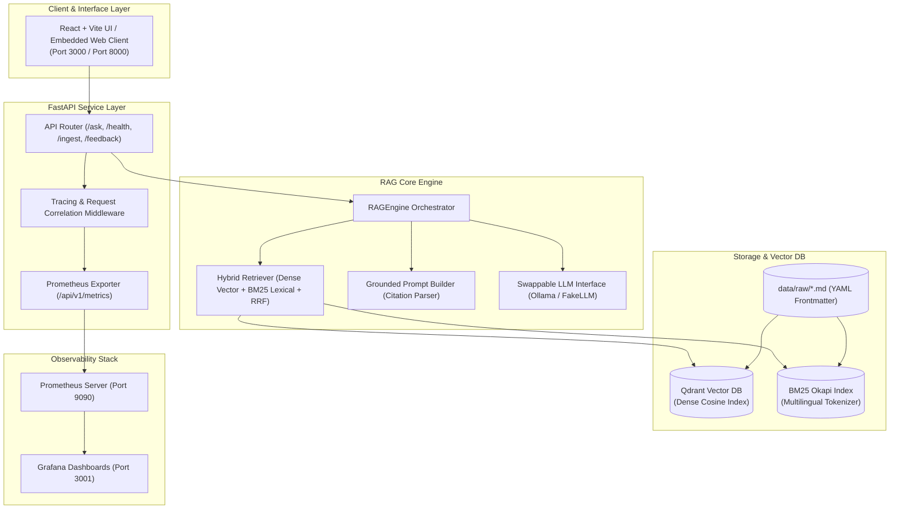

# 🇸🇪 SveaRAG: Agile-Managed Swedish Public Services RAG Assistant

[](https://github.com/example/svearag/actions)
[](file:///Users/adithya/Desktop/Agile%20managed%20RAG%20based%20AI%20assistant/docs/DEFINITION_OF_DONE.md)
[](https://www.python.org/downloads/release/python-3110/)
[](https://opensource.org/licenses/MIT)
[](file:///Users/adithya/Desktop/Agile%20managed%20RAG%20based%20AI%20assistant/docker-compose.yml)

A production-grade, bilingual Retrieval-Augmented Generation (RAG) assistant designed for navigating Swedish public sector guidance (**Migrationsverket** residence permits & **Skatteverket** civil registration and taxes).

Developed across **4 structured Agile sprints** with empirical evaluation, strict citation grounding, OpenTelemetry tracing, Prometheus observability, and 100% network-isolated CI tests.

---

## 🏛️ System Architecture



---

## 📊 Empirical RAG Evaluation Results

Evaluated on a golden benchmark of **40 bilingual questions** (25 English, 10 Swedish, 5 Out-of-Domain Refusals):

| Retrieval Configuration | Hit Rate@3 | Hit Rate@5 | MRR (Mean Reciprocal Rank) | Honest Refusal Rate | Avg Latency |
| :--- | :--- | :--- | :--- | :--- | :--- |
| **Hybrid (Dense + BM25 RRF $\alpha=0.5$)** | **100.0%** | **100.0%** | **0.9238** | **100.0%** | **24.16ms** |
| **Dense Vector Only ($\alpha=1.0$)** | 94.29% | 100.0% | 0.8748 | 100.0% | 8.66ms |
| **BM25 Sparse Only ($\alpha=0.0$)** | 94.29% | 97.14% | 0.8786 | 100.0% | 0.26ms |

*See full evaluation methodology and results in [eval/results/benchmark_report.md](eval/results/benchmark_report.md).*

---

## 🏃 Quickstart Guide

### 1. Local Python Setup
```bash
# Clone and enter directory
cd "Agile managed RAG based AI assistant"

# Create virtual environment with Python 3.11+
python3.11 -m venv .venv
source .venv/bin/activate

# Install package in editable mode with dev dependencies
pip install -e ".[dev]"

# Run tests and verify code coverage (>=85%)
pytest

# Ingest and index Swedish public documents
svearag ingest

# Start the FastAPI server and web interface
uvicorn svearag.api.app:app --reload --host 0.0.0.0 --port 8000
```
Open `http://localhost:8000` in your browser to interact with the assistant!

---

### 2. Full-Stack Docker Compose
Launch Frontend, Backend, Qdrant Vector DB, Prometheus, and Grafana with one command:
```bash
docker compose up -d --build
```

| Service | URL | Description |
| :--- | :--- | :--- |
| **Web Chat Interface** | `http://localhost:3000` or `http://localhost:8000` | React / Interactive Chat with expandable citations |
| **FastAPI REST API & Docs** | `http://localhost:8000/docs` | Interactive OpenAPI Swagger documentation |
| **Prometheus Metrics** | `http://localhost:8000/api/v1/metrics` | Scrape endpoint |
| **Prometheus UI** | `http://localhost:9090` | Prometheus metric explorer |
| **Grafana Dashboards** | `http://localhost:3001` | Pre-configured metrics dashboard (login: `admin` / `admin`) |

---

## 📋 API Reference

- `POST /api/v1/ask`: Query the assistant with optional `agency`, `language`, and `alpha` filters.
- `GET /api/v1/health`: System health, indexed document count, and vector store status.
- `POST /api/v1/ingest`: Trigger reindexing of documents in `data/raw/`.
- `POST /api/v1/feedback`: Record user thumbs up / down ratings.
- `GET /api/v1/metrics`: Prometheus scrape metrics exporter.

---

## 📈 Agile Sprint History & Engineering Metrics

| Sprint | Story Points Delivered | Test Coverage | Key Milestones |
| :--- | :--- | :--- | :--- |
| [Sprint 1](docs/sprints/sprint-1-retrospective.md) | 21 Pts | 96.56% | Swedish public doc loader, semantic chunking, Qdrant vector store, BM25, and CI. |
| [Sprint 2](docs/sprints/sprint-2-retrospective.md) | 16 Pts | 96.62% | Grounded citation prompt, LLM adapter interface, FastAPI REST service, Dockerfile. |
| [Sprint 3](docs/sprints/sprint-3-retrospective.md) | 14 Pts | 96.66% | React + Vite UI, expandable citation inspector, feedback actions, `docker-compose.yml`. |
| [Sprint 4](docs/sprints/sprint-4-retrospective.md) | 21 Pts | 93.90% | 40-question golden evaluation benchmark, Prometheus metrics, Grafana dashboards. |
| **Total** | **72 Pts** | **$\ge 93.9\%$** | **Production-Ready Full-Stack Assistant** |

---

## 📄 Documentation Links
- [Product Vision & Problem Statement](docs/PRODUCT_VISION.md)
- [Definition of Done (DoD)](docs/DEFINITION_OF_DONE.md)
- [Product Backlog (18 User Stories)](docs/BACKLOG.md)
- [Architecture & Design Decisions](docs/ARCHITECTURE.md)
- [Sprint Retrospectives](docs/sprints/)
